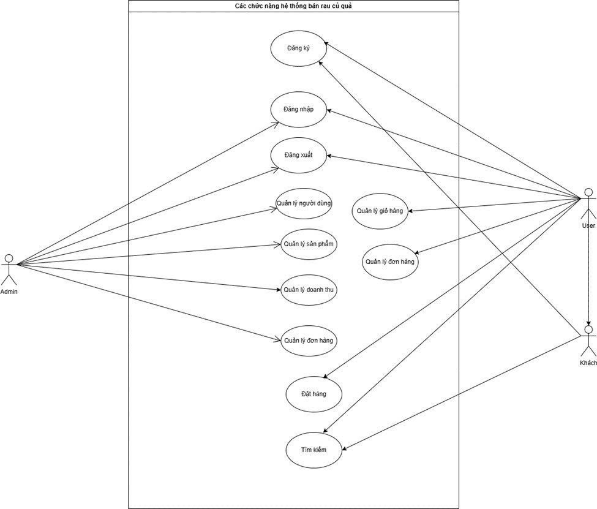
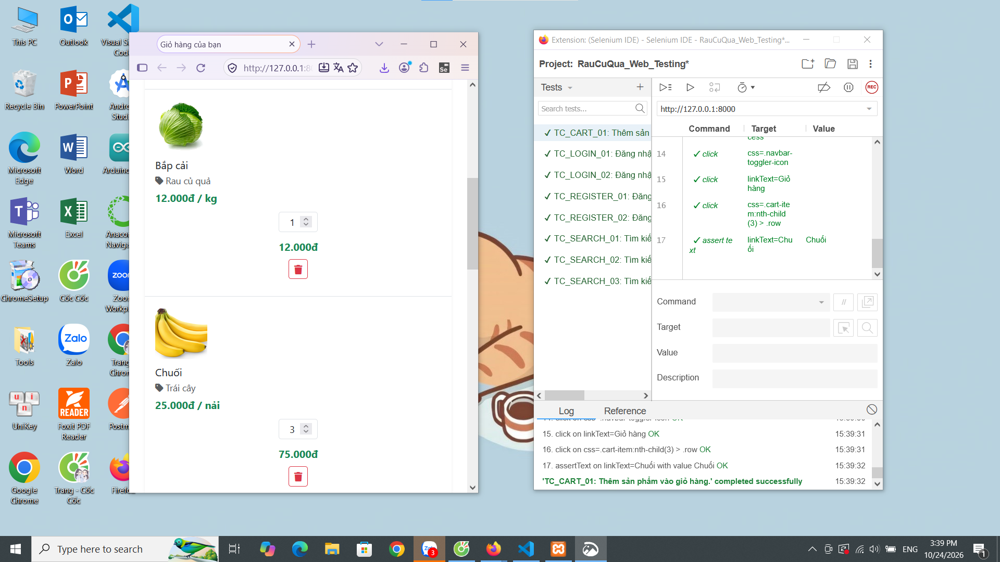
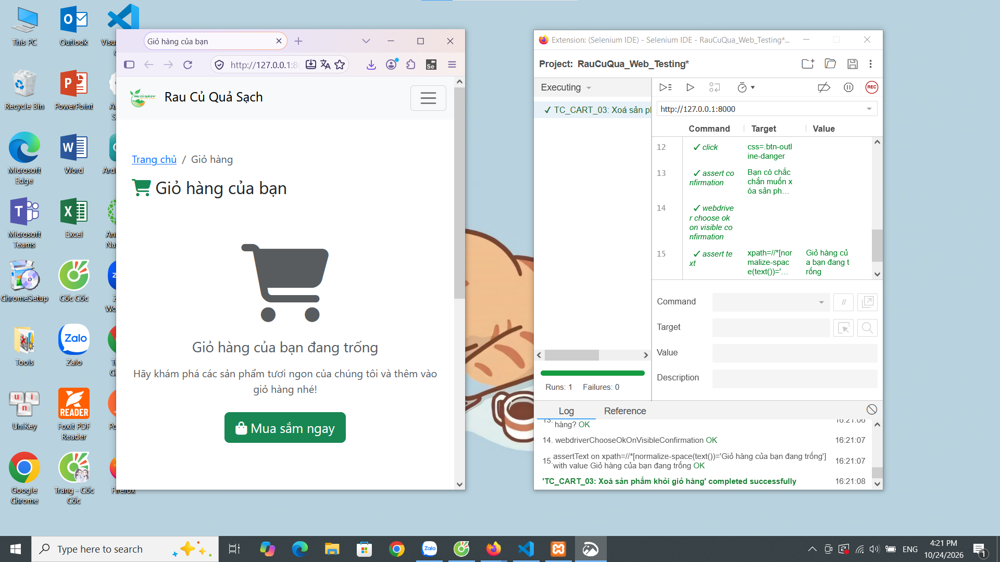

# 🥬 Kiểm thử website bán rau củ quả online

Dự án bài tập lớn học phần **Đánh giá và kiểm định chất lượng phần mềm**, Trường Công nghệ thông tin, Đại học Phenikaa.

Đề tài tập trung phân tích yêu cầu, xây dựng kế hoạch kiểm thử, thiết kế test case, thực thi và đánh giá chất lượng website bán rau củ quả trực tuyến.


## Mục lục

- [1. Thông tin đề tài](#1-thông-tin-đề-tài)
- [2. Mục tiêu](#2-mục-tiêu)
- [3. Chức năng](#3-chức-năng)
- [4. Công nghệ sử dụng](#4-công-nghệ-sử-dụng)
- [5. Cấu trúc dự án](#5-cấu-trúc-dự-án)
- [6. Cài đặt và chạy dự án](#6-cài-đặt-và-chạy-dự-án)
- [7. Kiểm thử phần mềm](#7-kiểm-thử-phần-mềm)
- [8. Kết quả kiểm thử](#8-kết-quả-kiểm-thử)
- [9. Các vấn đề đã biết](#9-các-vấn-đề-đã-biết)
- [10. Hướng phát triển](#10-hướng-phát-triển)
- [11. Tài liệu](#11-tài-liệu)

## 1. Thông tin đề tài

| Nội dung | Thông tin |
| --- | --- |
| Tên đề tài | Kiểm thử website bán rau củ quả online |
| Học phần | Đánh giá và kiểm định chất lượng phần mềm |
| Giảng viên hướng dẫn | TS. Trịnh Thanh Bình |
| Đơn vị | Trường Công nghệ thông tin, Đại học Phenikaa |
| Thời gian báo cáo | Tháng 10/2026 |

### Thành viên thực hiện

| STT | Họ và tên | Mã sinh viên |
| ---: | --- | --- |
| 1 | Phạm Thị Phương Anh | 23010706 |
| 2 | Nguyễn Quỳnh Trang | 23010651 |
| 3 | Vũ Thị Khánh Vân | 23010679 |

## 2. Mục tiêu

- Phân tích yêu cầu chức năng và phi chức năng của website.
- Mô hình hóa hệ thống bằng Use Case, Activity Diagram, Sequence Diagram và Class Diagram.
- Xây dựng kế hoạch, kịch bản và các trường hợp kiểm thử.
- Thực hiện kiểm thử hộp trắng, hộp đen và một số kịch bản giao diện bằng Selenium IDE.
- Phát hiện lỗi trong xử lý dữ liệu, phân quyền và các nghiệp vụ mua hàng.
- Tổng hợp kết quả, đánh giá chất lượng và đề xuất hướng khắc phục.

## 3. Chức năng

Website có ba nhóm tác nhân: **khách truy cập**, **khách hàng** và **quản trị viên**.

** Biểu đồ usecase tổng quát**


*Biểu đồ trích từ báo cáo, mô tả phạm vi yêu cầu. Một số chức năng trong thiết kế chưa được triển khai đầy đủ.*

### 3.1. Khách truy cập

- Xem danh sách và chi tiết sản phẩm.
- Tìm kiếm theo tên hoặc mô tả sản phẩm.
- Lọc theo danh mục và khoảng giá.
- Sắp xếp theo giá, tên, lượt xem hoặc thời gian tạo.
- Xem danh sách có phân trang, 4 sản phẩm mỗi trang.
- Đăng ký và đăng nhập bằng email, mật khẩu.

### 3.2. Khách hàng

- Đăng xuất và cập nhật hồ sơ cá nhân.
- Thêm sản phẩm vào giỏ hàng.
- Cộng dồn số lượng khi thêm lại cùng sản phẩm.
- Xóa sản phẩm khỏi giỏ hàng.
- Xem thành tiền từng dòng và tổng tiền.
- Đặt hàng từ giỏ hàng.
- Chọn phương thức COD hoặc luồng QR.
- Xem lịch sử, chi tiết và hủy đơn hàng của mình.

### 3.3. Quản trị viên

- Đăng nhập vào khu vực quản trị.
- Xem, thêm, sửa và xóa sản phẩm.
- Tải ảnh sản phẩm.
- Xem danh sách, thêm và xóa tài khoản.
- Xem danh sách và chi tiết đơn hàng.
- Xác nhận thanh toán.
- Có mã xử lý thống kê doanh thu theo tháng và xuất báo cáo PDF.

### 3.4. Luồng thanh toán QR

Mã QR hiện chứa liên kết tới trang thanh toán của đơn hàng. Quản trị viên kiểm tra và xác nhận thủ công để chuyển:

- `payment_status` sang `paid`.
- `status` sang `completed`.

## 4. Công nghệ sử dụng

| Thành phần | Công nghệ |
| --- | --- |
| Backend | PHP từ 8.2, Laravel 12 |
| Kiến trúc | MVC |
| Giao diện | Blade, HTML, CSS, JavaScript |
| Thư viện giao diện | Bootstrap 5.3, Font Awesome |
| Công cụ frontend | Vite 6; Tailwind CSS 4 và Axios được khai báo trong `package.json` |
| Cơ sở dữ liệu mặc định | SQLite |
| Truy cập dữ liệu | Eloquent ORM |
| Xác thực và phân quyền | Session, middleware |
| Xuất PDF | Laravel DomPDF |
| Kiểm thử PHP | PHPUnit 11, Laravel Feature Test |
| Kiểm thử JavaScript | Node.js, Node VM, DOM và timer mô phỏng |
| Kiểm thử giao diện | Selenium IDE |
| Đo độ bao phủ theo báo cáo | Xdebug, PHPUnit |

Tìm kiếm, lọc, sắp xếp và phân trang sản phẩm được xử lý bằng JavaScript trên dữ liệu server truyền vào Blade.

## 5. Cấu trúc dự án

Cây thư mục dưới đây trình bày các thành phần chính. Thư mục `docs/images/` được bổ sung cùng README.

```text
DGKD_Website_ban_rau_cu_online/
├── app/
│   ├── Http/
│   │   ├── Controllers/
│   │   │   ├── Admin/
│   │   │   │   ├── AdminController.php
│   │   │   │   ├── CategoryController.php
│   │   │   │   ├── OrderController.php
│   │   │   │   ├── ProductController.php
│   │   │   │   └── UserController.php
│   │   │   ├── AuthController.php
│   │   │   ├── CartController.php
│   │   │   ├── Controller.php
│   │   │   ├── OrdersController.php
│   │   │   ├── ProductController.php
│   │   │   └── UserController.php
│   │   └── Middleware/
│   │       ├── AdminMiddleware.php
│   │       ├── AuthMiddleware.php
│   │       ├── LoginMiddleware.php
│   │       └── UserMiddleware.php
│   ├── Models/
│   │   ├── Cart.php
│   │   ├── CartItem.php
│   │   ├── Category.php
│   │   ├── Order.php
│   │   ├── OrderItem.php
│   │   ├── Product.php
│   │   └── User.php
│   └── Providers/
├── bootstrap/
├── config/
├── database/
│   ├── factories/
│   ├── migrations/
│   └── seeders/
│       ├── DatabaseSeeder.php
│       ├── UserSeeder.php
│       ├── CategorySeeder.php
│       ├── ProductSeeder.php
│       ├── CartSeeder.php
│       ├── CartItemSeeder.php
│       ├── OrderSeeder.php
│       └── OrderItemSeeder.php
├── docs/
│   └── images/
│       ├── website-home.png
│       ├── use-case-overview.png
│       ├── selenium-search.png
│       ├── selenium-cart.png
│       ├── selenium-empty-cart.png
│       └── SOURCES.md
├── public/
│   ├── images/
│   └── index.php
├── reports/
├── resources/
│   ├── css/
│   ├── js/
│   └── views/
│       ├── admin/
│       │   ├── categories/
│       │   ├── orders/
│       │   ├── products/
│       │   ├── reports/
│       │   ├── users/
│       │   └── dashboard.blade.php
│       ├── auth/
│       ├── cart/
│       ├── layouts/
│       ├── orders/
│       ├── pdf/
│       ├── products/
│       ├── home.blade.php
│       └── welcome.blade.php
├── routes/
│   ├── console.php
│   └── web.php
├── storage/
├── tests/
│   ├── Feature/
│   │   ├── BlackBox/
│   │   └── WhiteBox/
│   ├── JavaScript/
│   │   └── whitebox.cjs
│   ├── Unit/
│   ├── verification/
│   └── TestCase.php
├── .env.example
├── artisan
├── build_whitebox_dashboard.php
├── composer.json
├── composer.lock
├── package.json
├── phpunit.xml
├── phpunit.blackbox.xml
├── phpunit.whitebox.extended.xml
├── vite.config.js
└── README.md
```

### Vai trò các thành phần

| Đường dẫn | Vai trò |
| --- | --- |
| `app/Http/Controllers/` | Xử lý request và nghiệp vụ |
| `app/Http/Middleware/` | Kiểm tra đăng nhập, vai trò và quyền truy cập |
| `app/Models/` | Các thực thể và quan hệ dữ liệu |
| `database/migrations/` | Khai báo cấu trúc bảng |
| `database/seeders/` | Tạo dữ liệu mẫu |
| `resources/views/` | Giao diện Blade và JavaScript nhúng |
| `routes/web.php` | Các tuyến truy cập website |
| `tests/Feature/WhiteBox/` | Kiểm thử hộp trắng PHP |
| `tests/Feature/BlackBox/` | Kiểm thử hộp đen PHP |
| `tests/JavaScript/` | Kiểm thử JavaScript trích từ Blade |
| `reports/` | Báo cáo kết quả đã lưu |
| `docs/images/` | Ảnh minh họa README |
| `storage/` | File tải lên, session, cache và log |

## 6. Cài đặt và chạy dự án

### 6.1. Yêu cầu

- Git.
- PHP từ 8.2.
- Composer
- Kết nối Internet để tải thư viện CDN trên giao diện.
- Xampp
### 6.2. Tải mã nguồn

```bash
git clone https://github.com/nguyentrang05/DGKD_Website_ban_rau_cu_online.git
cd DGKD_Website_ban_rau_cu_online
```

### 6.3. Cài thư viện PHP

```bash
composer install
```

### 6.4. Tạo cấu hình môi trường

```bash
php -r "file_exists('.env') || copy('.env.example', '.env');"
php artisan key:generate
```

Cập nhật `.env`:

```
DB_CONNECTION=mysql
DB_HOST=127.0.0.1
DB_PORT=3306
DB_DATABASE=rau_cu_qua_online
DB_USERNAME=root
DB_PASSWORD=
```

### 6.5. Tạo cơ sở dữ liệu

Chạy trên cơ sở dữ liệu mới:

```bash

php artisan migrate --seed
php artisan storage:link
```

**Lưu ý:**
- Mở phpMyAdmin tạo database rau_cu_qua_online sau đó chạy các lệnh trên

### 6.6. Khởi động website

```bash
php artisan serve
```

Truy cập: **http://127.0.0.1:8000**


### 6.8. Tài khoản mẫu

| Vai trò | Email | Mật khẩu | Trang sau đăng nhập |
| --- | --- | --- | --- |
| Quản trị viên | `admin@gmail.com` | `admin` | `/admin` |
| Khách hàng | `user@gmail.com` | `user` | `/home` |

> Đây là tài khoản do seeder tạo để thử nghiệm local. Mật khẩu ngắn là dữ liệu mẫu có sẵn; tài khoản đăng ký mới yêu cầu mật khẩu tối thiểu 8 ký tự.

## 7. Kiểm thử phần mềm

### 7.1. Kiểm thử hộp trắng

Phân tích mã nguồn, điều kiện rẽ nhánh, luồng điều khiển và sự thay đổi dữ liệu.

Các nhóm kiểm thử gồm:

- Đăng nhập và bảo vệ tài khoản.
- Đăng ký và kiểm tra yêu cầu đầu vào.
- Thêm, xóa và xử lý giỏ hàng.
- Dữ liệu sản phẩm.
- Tìm kiếm, lọc, sắp xếp và phân trang bằng JavaScript.

Chạy bộ PHP:

```bash
php artisan config:clear

php vendor/bin/phpunit -c phpunit.whitebox.extended.xml --testdox --log-junit reports/whitebox-rerun.xml
```

Chạy một suite:

```bash
php vendor/bin/phpunit -c phpunit.whitebox.extended.xml --testsuite RegistrationCore
```

### 7.2. Kiểm thử hộp đen

Áp dụng:

- Phân vùng tương đương.
- Phân tích giá trị biên.
- Bảng quyết định.
- Kiểm tra phản hồi HTTP và trạng thái dữ liệu sau thao tác.

Phạm vi gồm đăng nhập, đăng ký, hồ sơ, giỏ hàng và đơn hàng.

```bash
php vendor/bin/phpunit -c phpunit.blackbox.xml --testdox --log-junit reports/blackbox-rerun.xml
```

Hai cấu hình kiểm thử PHP chuyên biệt sử dụng MySQL trong bộ nhớ (`:memory:`), session/cache dạng array và dữ liệu tạo riêng theo test.

### 7.3. Kiểm thử JavaScript

Chạy 42 ca chính:

```bash
node tests/JavaScript/whitebox.cjs --suite core --output reports/javascript-core-rerun.json
```

Chạy ca yêu cầu bổ sung về tìm kiếm không dấu:

```bash
node tests/JavaScript/whitebox.cjs --suite requirements --output reports/javascript-requirements-rerun.json
```

Chạy toàn bộ:

```bash
node tests/JavaScript/whitebox.cjs --suite all --output reports/javascript-all-rerun.json
```

Runner sử dụng các module có sẵn của Node.js, không cần `npm install`.

### 7.4. Kiểm thử giao diện bằng Selenium IDE

Báo cáo mô tả kịch bản cho bốn nhóm chức năng:

- Tìm kiếm sản phẩm.
- Đăng ký.
- Đăng nhập.
- Quản lý giỏ hàng.

#### Kiểm thử tìm kiếm bằng Selenium IDE


#### Kiểm thử thêm sản phẩm vào giỏ hàng bằng Selenium



#### Kiểm thử xóa sản phẩm bằng Selenium



Repository hiện chưa có file dự án Selenium IDE `.side`; cần bổ sung để người khác phát lại các kịch bản.

## 8. Kết quả kiểm thử

Số liệu dưới đây được trích từ **Phần III - Thực hiện kiểm thử** của báo cáo giữa kỳ, không phải kết quả thực thi mới khi viết README.

### 8.1. Tổng hợp

| Bộ kiểm thử | Tổng ca | Pass | Failure | Error |
| --- | ---: | ---: | ---: | ---: |
| Hộp trắng PHP | 66 | 56 | 9 | 1 |
| JavaScript chính | 42 | 42 | 0 | 0 |
| **Tổng hộp trắng chính** | **108** | **98** | **9** | **1** |
| JavaScript yêu cầu bổ sung JR01 | 1 | 0 | 1 | 0 |
| Hộp đen | 106 | 81 | 17 | 8 |

Ca `JR01` kiểm tra tìm kiếm tiếng Việt không dấu và được tách riêng vì cần thống nhất tiêu chí chấp nhận.

Đợt hộp trắng ngày **25/10/2026** ghi nhận:

- PHP 8.3.6.
- Laravel 12.18.0.
- PHPUnit 11.5.22.
- SQLite trong bộ nhớ.
- Bootstrap tương thích nạp đúng lớp `AuthController` khi chạy trên Linux.

Bootstrap tương thích được mô tả trong gói minh chứng báo cáo nhưng chưa có trong repository được đối chiếu. Vì vậy, chạy source nguyên trạng có thể cho kết quả khác.

### 8.2. Chi tiết hộp đen

| Nhóm chức năng | Tổng ca | Đạt | Không đạt |
| --- | ---: | ---: | ---: |
| Đăng nhập và phân quyền | 21 | 21 | 0 |
| Đăng ký | 29 | 21 | 8 |
| Hồ sơ cá nhân | 16 | 16 | 0 |
| Giỏ hàng | 25 | 13 | 12 |
| Đơn hàng và xác nhận thanh toán | 15 | 10 | 5 |
| **Tổng** | **106** | **81** | **25** |

Tỷ lệ đạt: **76,4%**.

Trong 25 ca không đạt có **17 Failure** và **8 Error**. Các Error liên quan đến thiếu tuyến cập nhật giỏ hàng.

### 8.3. Độ bao phủ

Theo báo cáo, trong phạm vi **9 file PHP được khai báo đo**:

| Chỉ số | Độ bao phủ |
| --- | ---: |
| Dòng | 90,98% |
| Nhánh | 87,27% |
| Đường đi | 69,05% |

Các tỷ lệ này không đại diện cho toàn bộ website và không thay thế việc đánh giá kết quả assertion.

### 8.4. Xem báo cáo

- [Dashboard hộp trắng](reports/whitebox-dashboard.html)
- [Báo cáo hộp đen HTML](reports/blackbox-result.html)
- [Kết quả hộp đen dạng văn bản](reports/blackbox-result.txt)
- [Thư mục báo cáo](reports/)

Tạo lại dashboard từ các file báo cáo đã lưu:

```bash
php build_whitebox_dashboard.php
```

Script chỉ tổng hợp báo cáo, không chạy test. File có hậu tố `rerun` trong các lệnh ví dụ được lưu riêng; muốn sử dụng trong dashboard cần cập nhật ánh xạ tên file đầu vào.

## 9. Các vấn đề đã biết

| Vấn đề | Hiện trạng |
| --- | --- |
| Tên controller xác thực | `Authcontroller` trong route khác chữ hoa/thường với `AuthController`, có thể lỗi trên Linux. |
| Cập nhật số lượng giỏ | Chưa có route và phương thức `cart.update`. |
| Kiểm tra số lượng | Chưa bắt buộc số nguyên dương, có thể làm sai tồn kho. |
| Chọn giỏ hoạt động | Khi thêm hàng, truy vấn chỉ theo `user_id`, có thể chọn giỏ inactive. |
| Tổng tiền trong model | Accessor tổng giỏ dùng `sum(Closure)` trên quan hệ truy vấn, gây `TypeError` trong test. |
| Đăng ký | Chưa kiểm tra đầy đủ số điện thoại, điều khoản và chưa lưu phone/address từ form. |
| Đặt hàng | Chưa kiểm tra chặt phương thức thanh toán và ngày giao hàng. |
| Hủy đơn | Chưa chặn đầy đủ việc hủy đơn đã thanh toán, đang xử lý hoặc hoàn thành. |
| Quản trị | Một số route resource chưa có phương thức xử lý; ghi chú đơn thiếu migration cột `notes`. |
| Ảnh dữ liệu mẫu | Seeder dùng URL `example.com`, chưa phù hợp với cách ghép đường dẫn `/storage/`. |

Phần tổng hợp cuối báo cáo có nội dung chưa thống nhất với phần thực thi chi tiết. README sử dụng số liệu Phần III và mô tả chức năng theo mã nguồn đã đối chiếu.

## 10. Hướng phát triển

- Hoàn thiện cập nhật số lượng giỏ hàng phía server.
- Kiểm tra số lượng hợp lệ và đồng bộ tồn kho.
- Bổ sung validation, lưu đầy đủ thông tin đăng ký.
- Kiểm soát trạng thái đơn hàng khi thanh toán và hủy.
- Hoàn thiện các chức năng quản trị còn thiếu.
- Chuẩn hóa dữ liệu mẫu và đường dẫn ảnh.
- Thống nhất yêu cầu tìm kiếm tiếng Việt không dấu.
- Bổ sung file Selenium IDE và kiểm tra trên trình duyệt thật.
- Chạy kiểm thử hồi quy sau khi sửa lỗi.
- Tích hợp kiểm thử tự động vào CI.
